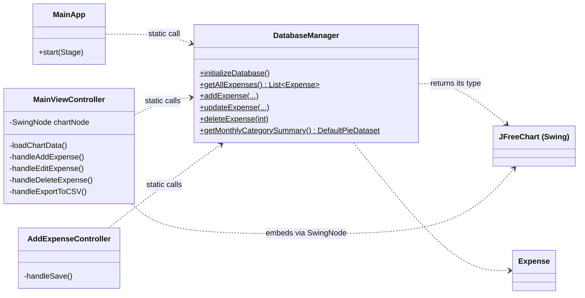
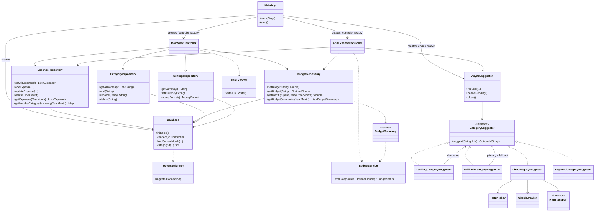
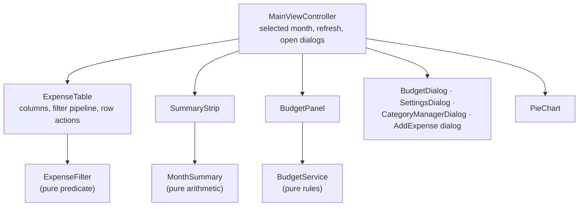
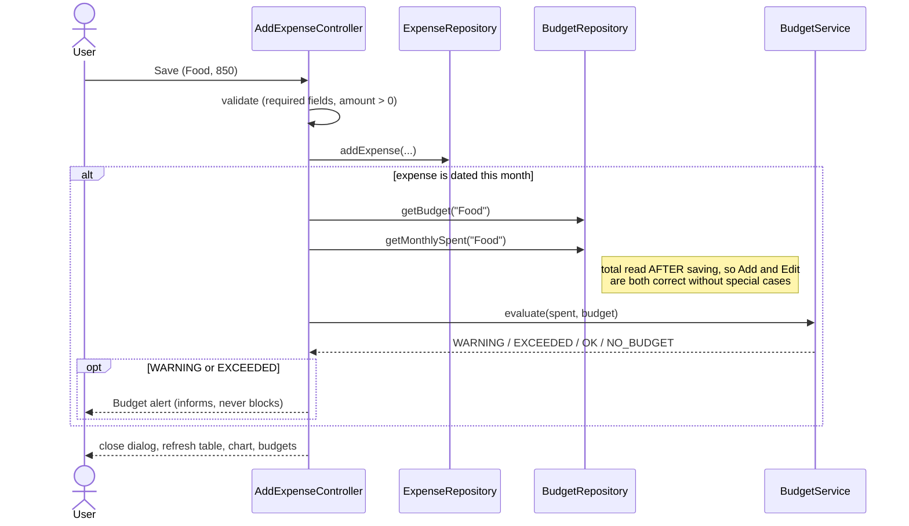
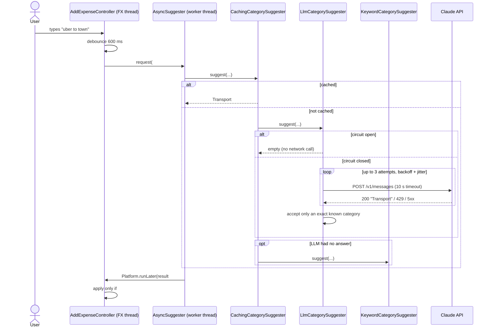

# Architecture

## Before (original project)

Every controller called static methods on one `DatabaseManager`, which also returned a
charting-library type. Nothing could be tested without the real database file and UI.

## After

`MainApp` is the single place that creates objects and wires them together (the
composition root). Controllers receive what they need through their constructors, so
every non-UI class can be tested on its own.

## Main window components (1.2)

`MainViewController` tracks the selected month, loads that month's data and hands it to
components that each own one part of the window.

Each JavaFX component is display-only; the logic it shows (`ExpenseFilter`, `MonthSummary`,
`BudgetService`) is plain Java and unit-tested without a UI.

## Saving an expense with a budget check

## Category suggestion while typing

