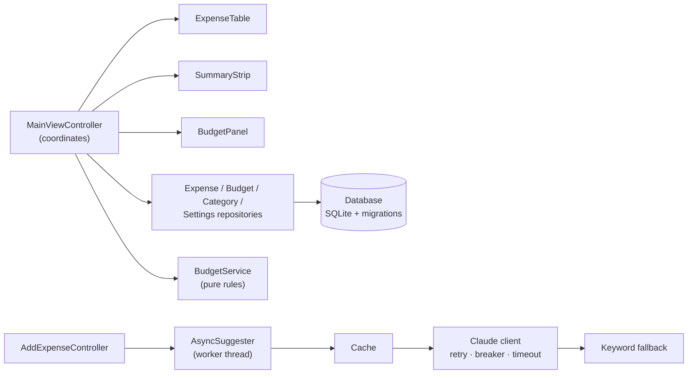

# Expense Tracker: budgets, AI categorisation and a hardened data layer

A JavaFX desktop app for tracking personal expenses, extended from a small CRUD project
into a tested, measured codebase. It adds monthly **category budgets** with alerts, a
**month-by-month view** with search and summaries, **AI-suggested categories** that degrade
gracefully when offline, and a data layer with **migrations, enforced constraints and
index-backed queries**.

> Built on [ykwise/java-ExpenseTracker-JavaFX-project](https://github.com/ykwise/java-ExpenseTracker-JavaFX-project)
> (CRUD, pie chart, CSV export). Everything below "What I added" is my work on top of it.

| | Original | Now |
|---|--:|--:|
| Automated tests | 0 | **112** (unit + integration) |
| CI | none | Linux + macOS on every push |

## Using the app

- **Months:** use ‹ and › (or ⌘← / ⌘→) to move between months. The table, chart, summary and
  budgets all show the selected month.
- **Summary:** the strip at the top shows what you spent, the change from last month, and how
  many budgets are on track.
- **Expenses:** **+ Add expense** (⌘N). Double-click a row or press Enter to edit; press ⌫ or
  right-click to delete. If you save an expense dated in another month, the view switches to it.
- **Search:** type in the search box (⌘F) to match description, category or amount, and narrow by
  category with the dropdown. The line under the table shows the total of what is listed.
- **Budgets:** **Set budget** gives a category a monthly limit. Bars turn amber at 80% and red when over.
- **Categories:** add, rename or delete your own. A category with expenses can be renamed but not deleted.
- **Settings:** choose the display currency (default KES).
- **Export CSV** saves every expense, in all months.

## What I added

**Budgets**
- Set a monthly budget per category (**Set Budget**).
- A **Budgets This Month** panel shows spend vs budget with green / amber / red progress bars.
- Saving an expense warns at **80%** and when the budget is **exceeded**. It informs, never blocks,
  because the money has already been spent and refusing to record it would make the data wrong.

**AI category suggestions**
- Type a description ("uber to town") and the category is filled in for you. You can always change it.
- With `ANTHROPIC_API_KEY` set it asks Claude; without it, offline keyword rules answer instantly.
- Claude's reply is only accepted if it exactly matches an existing category, so a
  hallucinated answer can never reach the database.

**Month view, search and categories**
- Month navigation, a summary strip, search and category filtering, category management,
  a currency setting and keyboard shortcuts. See the [changelog](CHANGELOG.md).
- A redesigned UI with one stylesheet: a calm ledger palette where colour only carries meaning
  (within budget, near the limit, over).

**Fixes to the original**
- Crash on launch on macOS (Apple Silicon): JavaFX 17.0.6 → 21.0.6.
- The Swing chart embedded in JavaFX (two UI toolkits, two threads) replaced with the native `PieChart`.
- CSV export replaced commas in your descriptions with semicolons; it now quotes fields properly (RFC 4180).
- An expense with an unknown category was saved with a NULL category and then vanished from the list.
- Foreign keys were declared but never enforced (SQLite ignores them unless switched on).
- Negative amounts were accepted; database errors were printed to the console and ignored.

## Engineering decisions

### Data layer
- **Repositories with constructor injection.** `Database`, `ExpenseRepository` and `BudgetRepository`
  replace an all-static `DatabaseManager`. `MainApp` is the single composition root; controllers get
  their dependencies through an FXML controller factory. This is what makes integration tests possible.
- **Versioned migrations.** The schema version lives in SQLite's `PRAGMA user_version`. Each migration
  runs in a **transaction together with its version bump**, so a failure rolls back completely
  (atomicity) and the database is never half-upgraded. Databases from the original app upgrade in place;
  this was verified against a real database with existing data.
- **Constraints in the database, not just the code.** Foreign keys are enforced on every connection;
  category names are `UNIQUE`; one budget per category via the primary key; `CHECK (monthly_limit > 0)`.
  Tests insert bad rows directly with SQL to prove the database itself rejects them.
- **Index-friendly queries.** "This month" was `strftime('%Y-%m', date) = ...`, which wraps the column
  in a function and forces a full table scan. It is now a half-open date range
  (`date >= first day AND date < first day of next month`) backed by an index on `(category_id, date)`.
  A test runs `EXPLAIN QUERY PLAN` (SQLite's EXPLAIN) and fails if the query ever scans the table again.
- **No N+1 queries.** The budget panel loads every budget and its spend in one `LEFT JOIN … GROUP BY`
  instead of two queries per category.
- **Idempotent writes.** Setting a budget is an upsert (`ON CONFLICT DO UPDATE`): repeating it is safe.

### Calling an LLM from a desktop app
The network will sometimes fail, so the suggestion pipeline is a chain of small decorators:
`cache → Claude (retries + circuit breaker) → keyword fallback`.

- **Retries with exponential backoff and full jitter**, only for transient failures (network errors,
  429, 5xx, 529). `Retry-After` is honoured; if the server asks for a longer wait than a suggestion is
  worth, it gives up instead. Client errors (400/401) are never retried. Retrying is safe because the
  request only reads.
- **Circuit breaker** (closed → open → half-open): after repeated failures, calls are skipped instantly
  for a minute, then a single trial call checks for recovery.
- **Timeouts** on connect (5 s) and on every request (10 s).
- **Bounded LRU cache** keyed by the category list and description, so changing the categories
  **invalidates** old answers; empty results aren't cached because they may come from an outage.
- **Background worker thread**, so typing never freezes the UI. Results go back to the JavaFX thread
  with `Platform.runLater`.
- **Race condition handled:** responses can arrive out of order (a slow answer for "ub" after the answer
  for "uber to town"). Each request carries a sequence number and only the latest result is applied.
  A test reproduces this ordering deterministically.
- **Debounced input** (600 ms) acts as client-side rate limiting: one request per pause, not per keystroke.
- **Graceful shutdown:** `Application.stop()` closes the worker, interrupting any in-flight call or backoff.

### Patterns deliberately *not* used
This is a single-user desktop app with a local SQLite file. Read replicas, sharding, partitioning,
Redis or distributed caches, load balancers, message queues, outbox, CQRS, event sourcing and
distributed tracing all solve problems of multiple servers or many concurrent users, which this app
doesn't have. Optimistic or pessimistic locking and connection pooling address concurrent writers;
here dialogs are modal, there is one user, and SQLite already runs transactions serializably.
Adding them would be complexity without a benefit.

## Architecture



- Class and sequence diagrams: [docs/ARCHITECTURE.md](docs/ARCHITECTURE.md)
- Why things are the way they are: [docs/adr/](docs/adr/README.md) (architecture decision records)
- CKJM metrics before and after, and the refactors they triggered: [docs/METRICS.md](docs/METRICS.md)
- What changed in each version: [CHANGELOG.md](CHANGELOG.md)

## Testing

```bash
mvn test
```

112 tests, all independent of the UI:
- **Integration tests** against a real SQLite file in a temp directory. Repositories take the month
  as a parameter, so month boundaries are deterministic (first and last day, December to January).
- **Category rules:** case-insensitive duplicates rejected by the database, renames carried through
  to expenses and budgets, and a refused delete leaving everything unchanged.
- **Migration tests:** fresh database, upgrading a database from the original app without losing data,
  running twice, and full rollback when a migration fails halfway.
- **Resilience tests** with a fake HTTP transport: retry counts, backoff bounds, `Retry-After`,
  no retries on 4xx, circuit breaker states, rejection of hallucinated categories.
- **Concurrency tests:** stale responses dropped, cancellation, and shutdown interrupting a stuck call.

CI runs the suite on Ubuntu and macOS for every push and pull request.

## Run it

Requires JDK 17+ and Maven.

```bash
mvn clean javafx:run
```

Optional, to turn on AI suggestions:

```bash
export ANTHROPIC_API_KEY=your-key
mvn javafx:run
```

The model defaults to `claude-haiku-5-5`; set `EXPENSE_AI_MODEL` to use another.

The window title shows "(AI suggestions on)" when a key is configured. Descriptions are sent to the
API only when a key is set; otherwise everything stays on your machine. The database file defaults
to `expenses.db` in the working directory; override with `-Dexpensetracker.db=/path/to/file.db`.

## Known limitations and next steps
- **Money is stored as `double`.** Fine for a personal tracker, but sums can show rounding artefacts
  such as 0.30000000000000004. The robust fix is `BigDecimal` in code and integer cents in the database,
  done as a migration.
- **`MainViewController` is still the biggest class.** It was split into components once the
  metrics flagged it, but it still coordinates a lot; see [docs/METRICS.md](docs/METRICS.md).
- **No UI tests.** Controllers are thin and the logic beneath them is tested, but TestFX tests for
  the dialogs would close that gap.
- Budgets are the same every month; per-month budgets would need a `(category_id, month)` key.

## Tech stack
Java 17, JavaFX 21 (FXML + CSS), SQLite (JDBC), JUnit 5, Maven, GitHub Actions, Claude API (optional)
